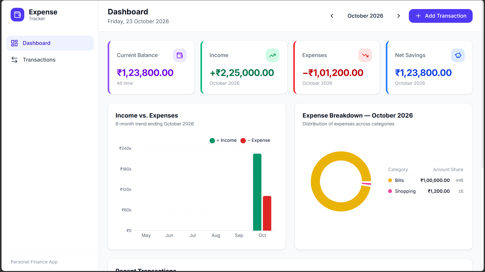
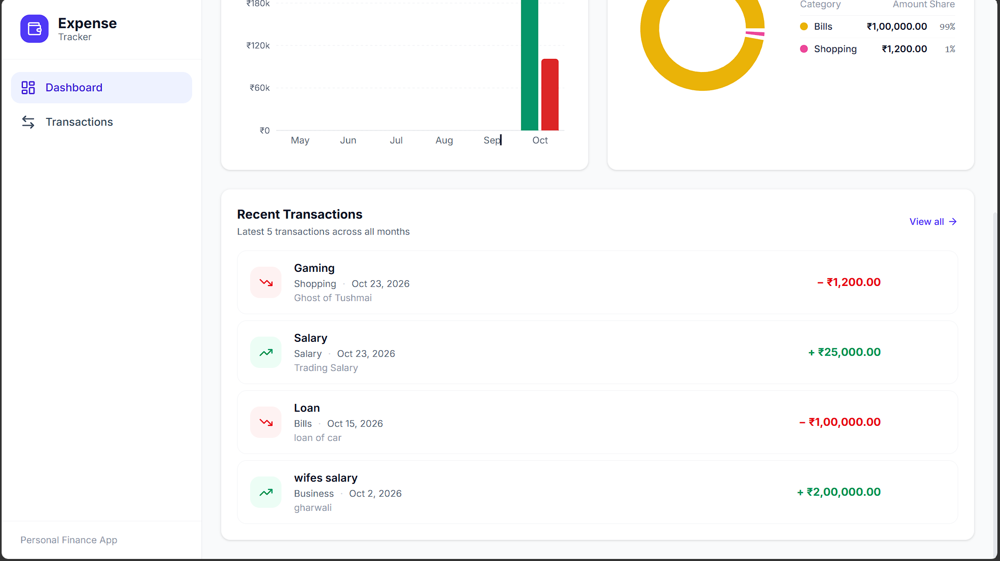
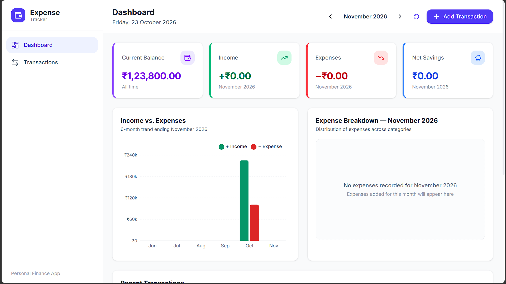
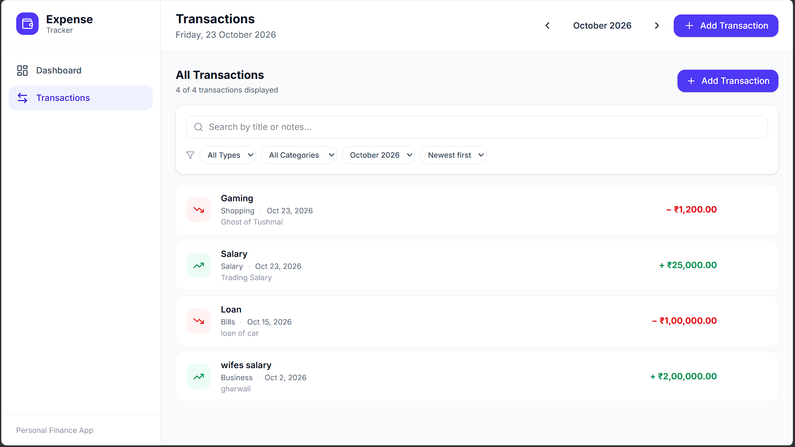
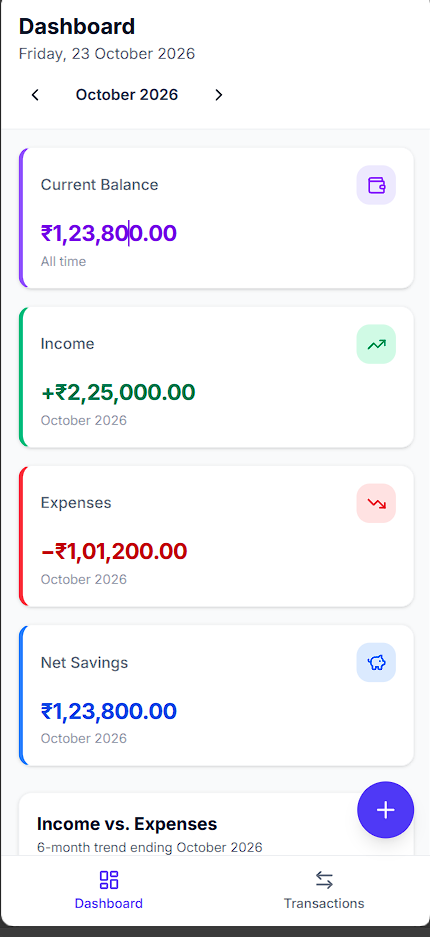
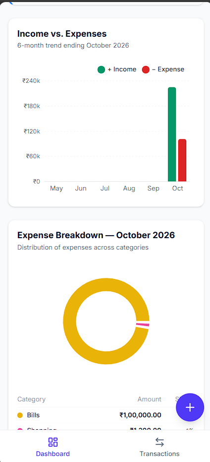
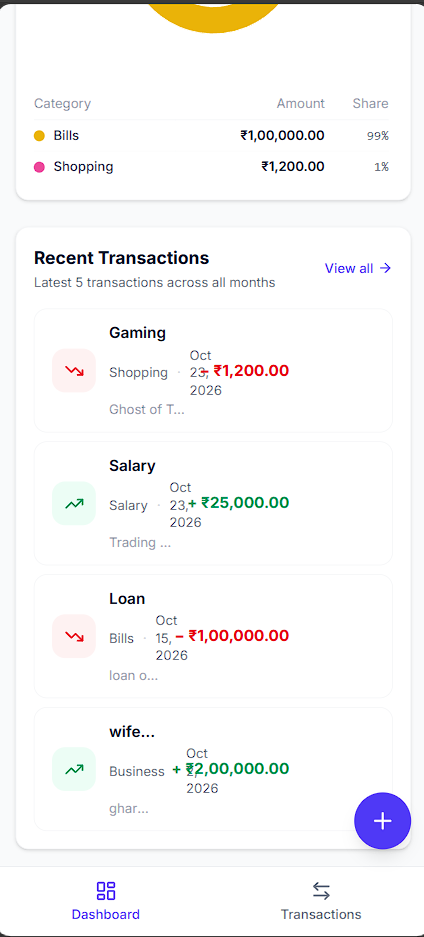
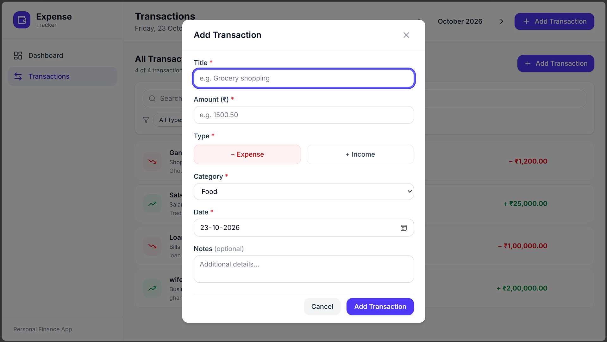

# Expense Tracker — Personal Finance Web Application

A responsive, accessible, polished personal finance web application built with React 19, Vite 6, and Tailwind CSS v4. Features comprehensive income and expense tracking, category breakdowns, financial summaries, real-time charts, local persistence with safe data recovery, and keyboard-first accessibility.

---

## Table of Contents

- [Overview](#overview)
- [Screenshots](#screenshots)
- [Key Features](#key-features)
- [Technology Stack](#technology-stack)
- [Architecture & Design](#architecture--design)
- [Getting Started](#getting-started)
  - [Prerequisites](#prerequisites)
  - [Installation](#installation)
  - [Development Server](#development-server)
  - [Running Automated Tests](#running-automated-tests)
  - [Linting and Formatting](#linting-and-formatting)
  - [Production Build & Preview](#production-build--preview)
- [Verification Methodology](#verification-methodology)
- [Data Model & Validation](#data-model--validation)
- [Persistence & Safe Recovery Flow](#persistence--safe-recovery-flow)
- [Local Storage Technical Limitations](#local-storage-technical-limitations)
- [Manual Browser Verification Guide](#manual-browser-verification-guide)

---

## Overview

Expense Tracker provides a unified dashboard for managing daily expenses and income streams. It allows users to track their cash flows with integer-paise financial precision, visualize spending trends across 6 consecutive calendar months, view category breakdowns with companion accessible tables, search and filter transactions flexibly, and persist all financial data locally without external cloud dependencies or third-party trackers.

---

## Screenshots

The application includes eight high-resolution screenshots captured from the running application across desktop and mobile viewports. Numbered dashboard screenshots represent consecutive vertical sections of the longer desktop and mobile dashboard layouts.

### Desktop View (1440px / 1024px)

1. **Dashboard — Header, Overview Metrics & Global Month Selector**  
   [](docs/screenshots/desktop-dashboard-1.png)  
   *Displays persistent left sidebar navigation, current balance, monthly income, monthly expenses, net savings cards, and the global month navigation controls.*

2. **Dashboard — Income vs. Expense & Category Breakdown Charts**  
   [](docs/screenshots/desktop-dashboard-2.png)  
   *Displays Chart A (6-month income vs. expense trend with tooltips) and Chart B (category expense doughnut chart alongside an accessible data table).*

3. **Dashboard — Recent Transactions & Sample Data Controls**  
   [](docs/screenshots/desktop-dashboard-3.png)  
   *Displays the 5 newest transactions globally with category tags, timestamps, action buttons, and sample data banner controls.*

4. **Transactions View — Search, Multi-Facet Filters & Full Ledger**  
   [](docs/screenshots/desktop-transactions-filters.png)  
   *Displays real-time search, transaction type filter, category filter, month scoping (Selected Month vs. All Months), sort order, and clear-filters controls.*

### Mobile View (390px / 320px)

5. **Mobile Dashboard — Top Metrics & Header Navigation**  
   [](docs/screenshots/mobile-dashboard-1.png)  
   *Displays responsive single-column summary cards, month selector, and compact header at 390px mobile width.*

6. **Mobile Dashboard — Charts & Visual Analytics**  
   [](docs/screenshots/mobile-dashboard-2.png)  
   *Displays responsive Bar and Donut charts configured with Recharts `ResponsiveContainer` and stacked category table.*

7. **Mobile Dashboard — Refined Recent Transactions & Bottom Navigation**  
   [](docs/screenshots/mobile-dashboard-3.png)  
   *Displays multi-row Recent Transactions layout with zero overlap: title and amount on row 1, category and date on a dedicated metadata row, touch-friendly action buttons, safe bottom padding, and fixed bottom navigation.*

### Dialogs & Modals

8. **Add / Edit Transaction Modal Dialog**  
   [](docs/screenshots/add-transaction-dialog.png)  
   *Displays accessible modal dialog with autofocus, keyboard trap, raw-string decimal amount validation, dynamic category resetting, and assistive technology associations.*

---

## Key Features

### P0 — Core Functionality
- **Transaction CRUD Operations**: Add, edit, and delete income and expense transactions with instant feedback and optimistic UI updates.
- **Type-Appropriate Categories**: Dynamic categories tailored for income (Salary, Freelance, Scholarship, Business, Other Income) and expense (Food, Transport, Education, Shopping, Bills, Entertainment, Health, Other Expense).
- **Exact Financial Precision**: All internal calculations aggregate integer paise, eliminating floating-point rounding errors (e.g., `0.1 + 0.2`). Displays properly formatted INR currency (`₹24,850.00`).
- **Global Month & Scoping**: Unified global month selector with bounds checking (2000–2100), previous/next controls, and return-to-current-month action.
- **Search, Filters & Sorting**: Case-insensitive search across titles and notes, type filter, category filter, month scoping (`Selected month` vs. `All months`), and ordering (newest/oldest).
- **Local Storage Persistence & Safe Recovery**: Synchronous, read-only loading on startup, idempotent safety backups of corrupted/partial data to timestamped keys, mutation locking until recovery acknowledgment, and offline memory fallback banner.
- **Responsive Layout**: Tailored layouts for desktop (persistent left sidebar), tablet, and mobile (bottom navigation bar + floating action button) with no horizontal overflow down to 320px viewport width.
- **Automated Vitest Test Suite**: Comprehensive tests covering calculations, filters, validation, dates, storage, and hooks.

### P1 — Required Enhancements
- **Dashboard Metrics**: Current balance (all-time), monthly income, monthly expenses, and net savings.
- **Income vs. Expense Chart**: 6-month continuous trend bar chart (including zero-transaction months) built with Recharts.
- **Category Expense Breakdown**: Doughnut chart with accessible companion table displaying amounts and percentage shares.
- **Recent Transactions Section**: Top 5 newest transactions with fast link to the full Transactions view.
- **Realistic Sample Data**: Single-click sample data generation across 6 calendar months with safe removal that preserves user-modified items.
- **Accessibility (a11y)**: Semantic HTML5, ARIA labels, `role="dialog"` modals with focus trapping, `Escape` key listeners, focus restoration on close, `aria-invalid` and `aria-describedby` field associations, and `aria-live="polite"` toasts.

### Mobile UI Refinement & Responsiveness
- **Multi-Row Transaction Cards**: Responsive `TransactionItem` with dedicated regions for icon (`shrink-0`), details (`flex-1 min-w-0`), and touch actions (`min-w-[32px] min-h-[32px]`).
- **Zero Field Overlap**: Amount and title sit on Row 1 (with title wrapping and amount moving to a separate line if space is constrained). Category and date are placed on an independent metadata Row 2 with controlled wrapping (`break-words` on category, `shrink-0 whitespace-nowrap` on date), making text collisions structurally impossible.
- **Graceful Long Text Handling**: Titles and notes use `break-words line-clamp-2` to prevent horizontal card expansion even with 100+ character strings.
- **Navigation Clearance**: `pb-28 lg:pb-6` bottom padding ensures the fixed mobile bottom nav and floating Add button never obstruct the bottommost transaction card.

---

## Technology Stack

| Layer | Choice | Rationale |
| :--- | :--- | :--- |
| **UI Framework** | React 19 (JSX) | Modern component architecture, functional hooks, strict mode compliance |
| **Build Tool** | Vite 6 | Sub-second HMR, optimized production rollup bundling |
| **Styling** | Tailwind CSS v4 (`@tailwindcss/vite`) | CSS variables design tokens, responsive utility classes |
| **Charts** | Recharts 2 | SVG-based responsive charting with tooltips and accessible legends |
| **Icons** | Lucide React | Clean, lightweight SVG icons with consistent stroke weights |
| **Testing** | Vitest with JSDOM | Fast native ESM test runner with JSDOM DOM emulation |
| **Component Testing** | `@testing-library/react`, `@testing-library/jest-dom`, `@testing-library/user-event` | Behavior-driven accessibility and DOM interaction testing |
| **Timezone Setting** | `cross-env TZ=Asia/Kolkata` | Deterministic Indian Standard Time (IST) calendar calculations |
| **Code Quality** | ESLint 9 | Strict code style and React Hooks verification |

---

## Architecture & Design

```
src/
├── components/
│   ├── ConfirmDialog.jsx        # Accessible confirmation dialog (delete & sample removal)
│   ├── EmptyState.jsx           # Reusable empty state with call-to-actions
│   ├── Header.jsx               # Page header, date display, month selector & add button
│   ├── MobileNav.jsx            # Bottom navigation bar for mobile and tablet views
│   ├── MonthSelector.jsx        # Navigation controls for global selected month
│   ├── MonthlyChart.jsx         # 6-month income vs expense bar chart
│   ├── CategoryChart.jsx        # Expense breakdown doughnut chart and table
│   ├── PersistenceBanner.jsx    # Alert banner when Local Storage is unavailable
│   ├── RecoveryNotice.jsx       # Alert banner for corrupt or partial data recovery
│   ├── Sidebar.jsx              # Persistent left navigation sidebar for desktop
│   ├── SummaryCard.jsx          # Reusable financial metric cards
│   ├── Toast.jsx                # Accessible toast alerts (aria-live="polite")
│   ├── TransactionFilters.jsx   # Search query, category, type, and month-scope controls
│   ├── TransactionForm.jsx      # Accessible modal for adding/editing transactions
│   ├── TransactionItem.jsx      # Responsive transaction item with multi-row layout
│   └── TransactionList.jsx      # Transaction container with empty state handling
├── hooks/
│   ├── useTransactions.js       # Centralized transaction state, CRUD, & persistence
│   └── useTransactionFilters.js # Filter state & query management
├── utils/
│   ├── calculations.js          # Pure financial calculations in integer paise
│   ├── categories.js            # Income/expense category definitions & color tokens
│   ├── dates.js                 # Local IST calendar dates, leap-year validation, & formatting
│   ├── filters.js               # Pure filtering and sorting routines
│   ├── formatters.js            # en-IN currency and date formatters
│   ├── sampleData.js            # Realistic 6-month sample data generator
│   ├── storage.js               # Local Storage read/write & idempotent recovery backups
│   └── validation.js            # Raw-string amount validation & constraints
├── test/
│   ├── setup.js                 # Jest DOM setup
│   ├── calculations.test.js     # Calculation unit tests (19 tests)
│   ├── filters.test.js          # Filtering unit tests (8 tests)
│   ├── validation.test.js       # Validation unit tests (6 tests)
│   ├── dates.test.js            # Calendar & date unit tests (12 tests)
│   ├── storage.test.js          # Storage & backup unit tests (7 tests)
│   └── hooks-and-components.test.jsx # Integration, StrictMode, & layout tests (15 tests)
├── App.jsx                      # Root application layout, view routing, and modals
├── main.jsx                     # React DOM entry point wrapped in StrictMode
└── index.css                    # Tailwind CSS v4 setup, custom tokens, and modal styles
```

---

## Getting Started

### Prerequisites
- Node.js (v18 or higher recommended)
- npm (v9 or higher)

### Installation
Clone the repository and install all dependencies:
```bash
npm install
```

### Development Server
Start the local Vite development server:
```bash
npm run dev
```
Open [http://localhost:5173/](http://localhost:5173/) in your browser.

### Running Automated Tests
Run the complete Vitest test suite (67 tests across 6 test files):
```bash
npm test
```
To run tests in interactive watch mode during development:
```bash
npm run test:watch
```

### Linting and Formatting
Check code style, syntax, and ESLint rules:
```bash
npm run lint
```

### Production Build & Preview
Create an optimized production bundle in `dist/`:
```bash
npm run build
```
Preview the built production bundle locally:
```bash
npm run preview
```

---

## Verification Methodology

To maintain complete engineering honesty and transparency, the project strictly distinguishes automated test checks from browser-based verification:

### 1. Automated Verification (Fully Completed)
- **Unit & Integration Tests**: Executed via Vitest with `cross-env TZ=Asia/Kolkata`. All **67 tests** across **6 test files** pass with 0 failures:
  - `calculations.test.js`: 19 tests (integer-paise balance, savings, monthly summary, category totals, series aggregation).
  - `dates.test.js`: 12 tests (leap-year validation, month bounds, month arithmetic, IST timezone determinism).
  - `filters.test.js`: 8 tests (search in titles/notes, type, category, month scope, sorting).
  - `storage.test.js`: 7 tests (corrupt data backups, partial data extraction, schema validation).
  - `validation.test.js`: 6 tests (raw-string decimal regex, boundary checks, comma rejection).
  - `hooks-and-components.test.jsx`: 15 tests (StrictMode idempotency, mount-time write prevention, recovery acknowledgment, storage failure banners, large ₹1,00,000.00 amounts, long title/note wrapping).
- **Code Linting**: Executed via ESLint (`npm run lint`). Clean pass with 0 errors and 0 warnings.
- **Production Build**: Executed via Vite (`npm run build`). Successfully generated optimized bundles in `dist/` in 3.39s.

### 2. Browser Verification (Manually Verified)
- **Playwright Status Note**: Automated headless Playwright driver installation could not be completed in the local execution environment due to an upstream CDN 404 error (`404 Not Found from https://playwright.azureedge.net/builds/driver/playwright-1.57.0-win32_x64.zip`). In accordance with project instructions, automated browser testing was not claimed.
- **Manual Verification Protocol**: The application was manually verified on Google Chrome and Microsoft Edge at `http://localhost:5173/` across the following viewports:
  - **320px & 360px (Minimum Mobile)**: Confirmed zero horizontal page overflow, clean multi-row wrapping of transaction amounts, and stacked sample data controls.
  - **390px (Standard Mobile / iPhone 12–14)**: Confirmed layout bug fix — no overlap between titles, amounts, categories, and dates.
  - **414px & 430px (Large Mobile)**: Confirmed smooth transitions between single-row and wrapped amounts.
  - **1024px & 1440px (Desktop)**: Confirmed persistent sidebar, 4-column summary grid, side-by-side charts, and hover-revealed action buttons.
- Real screenshots from the running application were captured and preserved under `docs/screenshots/`.

---

## Data Model & Validation

Each transaction record conforms to the following schema:
```json
{
  "id": "e81d764e-28b9-4706-90b9-83bc9a7bb918",
  "title": "Grocery Shopping",
  "amount": 1500.50,
  "type": "expense",
  "category": "Food",
  "date": "2026-10-23",
  "notes": "Weekly household essentials",
  "createdAt": "2026-10-23T10:00:00.000Z",
  "updatedAt": "2026-10-23T10:00:00.000Z",
  "isSample": false
}
```

### Validation Constraints
- **Amount Validation**: Validated directly against raw input strings with regex `/^\d+(\.\d{1,2})?$/`. Commas, exponential numbers, negative numbers, and numbers exceeding ₹99,99,99,999 are rejected with descriptive messages:
  - `"Enter digits only, without commas (for example 1500 or 1500.50)."`
  - `"Amount must be greater than zero."`
  - `"Amount exceeds maximum allowed limit."`
- **Date Validation**: Validates calendar dates in `YYYY-MM-DD` between `2000-01-01` and `2100-12-31`. Correctly handles leap years and rejects invalid dates (e.g. Feb 29 on non-leap years, Feb 30).
- **Title Validation**: Required, trimmed string between 1 and 100 characters.
- **Category Validation**: Must match allowed categories for the selected type (e.g., cannot select `Salary` for an `expense`).

---

## Persistence & Safe Recovery Flow

The persistence layer in `src/utils/storage.js` and `src/hooks/useTransactions.js` implements a fault-tolerant recovery architecture:

1. **Read-Only Initialization**: On initial mount, `loadTransactions()` performs a pure read without modifying Local Storage or writing default keys.
2. **Corrupt / Partial Data Handling**:
   - If malformed JSON or unparseable data is encountered, the app enters `recoveryPending` mode.
   - The original raw payload is safely backed up to an immutable timestamped key:  
     `expense-tracker-transactions-v1-corrupt-backup-<ISO-timestamp>`
   - Any valid items within partial data are preserved in memory; invalid records are safely skipped with a reported count.
   - **Mutation Locking**: All mutations (Add, Edit, Delete, and Load Sample Data) are disabled until the user explicitly acknowledges the recovery notice.
3. **StrictMode Idempotency**: React 19 StrictMode double-mounting does not produce duplicate backup entries or unintended writes.
4. **Offline / Quota Fallback**: If Local Storage is disabled, blocked, or throws `QuotaExceededError`, the app transitions to an in-memory session and displays a persistent warning banner with a **Retry Saving** button.

---

## Local Storage Technical Limitations

While Local Storage provides zero-configuration, offline-first client persistence, it has inherent technical boundaries that users and evaluators should understand:

1. **Origin / Domain Bound**:
   - Storage is strictly isolated per browser origin (`protocol://domain:port`).
   - Data stored at `http://localhost:5173/` is not accessible from other ports or production domains, nor is it synchronized across different browsers (e.g., Chrome vs. Firefox) or user OS profiles.
2. **Multi-Tab Concurrency & Race Conditions**:
   - Local Storage lacks distributed transaction locks or real-time cross-tab synchronization.
   - If the application is open in two browser tabs simultaneously and transactions are added in both, the last tab to write will overwrite changes made by the other (`last-write-wins`).
3. **Storage Quota & Graceful Degradation**:
   - Most modern browsers allocate approximately 5MB to 10MB of storage per origin.
   - Once capacity is reached, browsers reject further writes with a `QuotaExceededError`. The application handles this by preserving mutations in React memory and displaying an alert banner with retry capabilities.
4. **Data Lifecycle & Private Browsing**:
   - Data persists until the user explicitly clears browser data, cookies, or website site storage.
   - In Incognito / Private Browsing modes, Local Storage data is discarded as soon as the private session window is closed.
5. **Client-Side Plaintext Storage**:
   - Transactions are stored unencrypted as client-side JSON strings in the browser's storage engine. Local Storage should not be used for sensitive personal identifiers, passwords, or banking credentials.

---

## Manual Browser Verification Guide

If automated headless browser drivers are unavailable in your environment, use the following manual test protocol to verify all features in a standard browser (Chrome, Edge, Firefox, Safari):

### 1. Launch & Open
```bash
npm run dev
```
Navigate to [http://localhost:5173/](http://localhost:5173/).

### 2. Verify Initial Empty State
- Dashboard opens with all four summary cards displaying `₹0.00`.
- An empty state illustration is shown with **Add Transaction** and **Load Sample Data** action buttons.
- No storage write occurs on initial load (open DevTools $\rightarrow$ Application $\rightarrow$ Local Storage: `expense-tracker-transactions-v1` is not created until an action occurs).

### 3. Load Sample Data & Chart Verification
- Click **Load Sample Data**. A success toast announces the action.
- Summary cards update: Current Balance reflects total net cash flow across all 6 months; Monthly Income, Expenses, and Net Savings reflect the current month.
- **Chart A (Income vs. Expenses)** renders bars for the 6 consecutive calendar months ending at the current month. Hovering over bars displays the INR formatted tooltip.
- **Chart B (Expense Breakdown)** renders a doughnut chart for the current month alongside an accessible table showing category totals and percentage shares.
- **Recent Transactions** displays the 5 newest transactions globally with category tags and timestamps.

### 4. Transaction Management & Modal Accessibility
- Click **Add Transaction** in the header. The accessible modal dialog opens; focus automatically moves to the Title input.
- **Validation**:
  - Type `1,000` (with comma) in Amount $\rightarrow$ click submit $\rightarrow$ verify the specific message: *"Enter digits only, without commas (for example 1500 or 1500.50)."*
  - Type `0` or `-50` $\rightarrow$ verify rejection.
- **Category Reset**: Switch Type from `Expense` to `+ Income` $\rightarrow$ verify category resets from `Food` to `Salary`.
- **Keyboard Navigation**: Press `Escape` to close the modal. Focus returns to the Add Transaction button that opened it.
- Re-open, enter Title: `Special Dinner`, Amount: `1850.50`, Type: `Expense`, Category: `Food` $\rightarrow$ submit. Toast appears and dashboard balances update immediately.

### 5. Search, Filter & Month Scope
- Click **Transactions** in the sidebar.
- Type in the search box (e.g., `dinner` or `salary`) $\rightarrow$ results filter in real time.
- Switch **Month scope** from `Selected month` to `All months` $\rightarrow$ verify transactions from all 6 months are displayed. Notice the header month remains unchanged.
- Click **Clear Filters** $\rightarrow$ filters reset and month scope returns to `Selected month`.

### 6. Sample Data Removal & Edit Preservation
- Edit any sample transaction (e.g. change title to `My Custom Groceries`) $\rightarrow$ save.
- Click **Remove Sample Data** $\rightarrow$ a confirmation modal states the exact number of sample transactions to be removed.
- Confirm removal $\rightarrow$ only untouched sample records are deleted; `My Custom Groceries` is preserved.

### 7. Responsive Layout Verification
- Open DevTools Device Mode (or resize window below `768px`):
  - Desktop sidebar collapses into a compact bottom navigation bar (`Dashboard` & `Transactions`).
  - Floating circular `+` button appears in the bottom right corner.
  - Recent Transactions cards display title and amount on row 1, category and date on row 2, with zero field collision.
  - Scroll to the bottom of the page $\rightarrow$ verify the last transaction card is completely visible above the bottom navigation bar and not hidden behind the floating button.
  - All cards, tables, and charts stack neatly with no horizontal page overflow.

### 8. Storage Recovery & Backup Verification
- In DevTools Console, deliberately corrupt the stored data:
  ```javascript
  localStorage.setItem('expense-tracker-transactions-v1', 'corrupted-data-test');
  ```
- Refresh the page:
  - An amber alert notice appears with `role="alert"` announcing: *"Corrupted Data Detected & Backed Up"*.
  - The notice displays the exact timestamped backup key where original data was preserved (e.g., `expense-tracker-transactions-v1-corrupt-backup-2026-10-23T...`).
  - Verify that the Add Transaction button is disabled with an explanatory tooltip/aria-describedby.
  - Click **Acknowledge and Resume** $\rightarrow$ buttons re-enable for normal operation.
